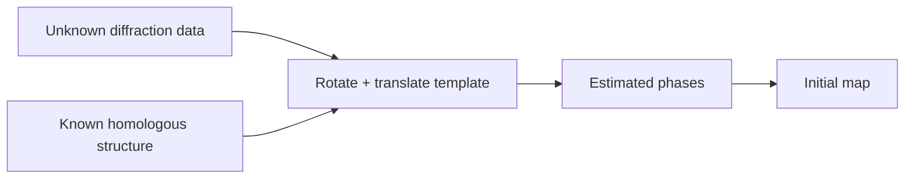

---
title: Molecular Replacement
type: method
tags: [crystallography, phasing]
lectures: [L04]
updated: 2026-10-19
status: draft
---

# Molecular Replacement

Molecular replacement solves the [[phase-problem]] by using a related known structure as a template to estimate phases [L4, p.1].

*Takeaway: molecular replacement trades experimental phasing for template dependence.*

Limits: low homology, conformational changes or missing domains can create model bias [L4, p.1].

