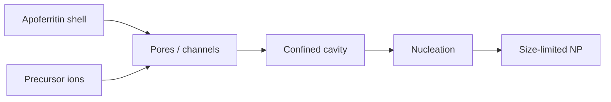

---
title: Nanoparticle Synthesis in Nanoreactors
type: method
tags: [nanoreactors, nanoparticles, porous-materials]
lectures: [L05, L09]
updated: 2026-10-19
status: draft
---

# Nanoparticle Synthesis in Nanoreactors

Nanoparticle synthesis in nanoreactors uses hollow or nanoporous containers to confine precursor reaction and particle growth [L5, p.13].

*Takeaway: confinement limits growth, but inhomogeneous pore filling can cause polydispersity [L5, p.13].*

## Lecture 9 extension — apoferritin containers
Lecture 9 identifies [[apoferritin]] as a protein nanoreactor: its cavity constrains nanoparticle size, the synthesis can occur under mild conditions, and the final product has a defined biological shell that can be functionalized with targeting ligands or water-soluble cargo [L9, p.15]. The lecture lists iron oxide in ferritin for cancer-related treatment examples and non-iron products such as silver, PbS and quantum dots [L9, p.15].

*Takeaway: protein cages provide nanoscale confinement plus a biocompatible exterior [L9, p.15].*

### Size constraint
$$d_{\mathrm{product}}\lesssim d_{\mathrm{cavity}}$$

| Symbol | Meaning | Units / notes |
|---|---|---|
| $d_{\mathrm{product}}$ | product nanoparticle diameter | nm |
| $d_{\mathrm{cavity}}$ | nanoreactor cavity diameter | nm |

Assumptions: geometric upper bound only; pore transport and number of nuclei can broaden sizes.
