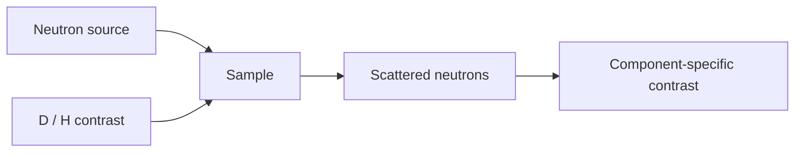

---
title: Neutron Scattering
type: method
tags: [neutrons, scattering, isotopes]
lectures: [L06]
updated: 2026-10-19
status: draft
---

# Neutron Scattering

Neutron scattering uses nuclear/spallation sources and measures scattering from nuclei [L6, p.26]. Advantages over SAXS include sensitivity to light elements, isotope labelling and magnetic moments [L6, p.26].

*Takeaway: neutrons see isotope and magnetic/nuclear contrast differently from X-rays.*

