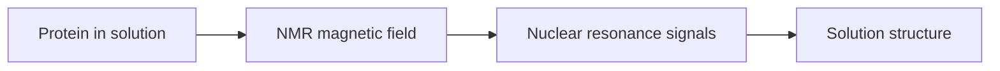

---
title: Nuclear Magnetic Resonance
type: method
tags: [nmr, structure, solution]
lectures: [L03]
updated: 2026-10-19
status: draft
---

# Nuclear Magnetic Resonance

Lecture 3 lists nuclear magnetic resonance (NMR) as a method for experimental determination of protein structure: it works in solution but is time-consuming and size-limited [L3, p.13].

*Takeaway: NMR avoids crystallisation but is limited for large proteins.*

## Links
Contrasted with [[cryo-em]] and [[protein-crystallography]] in [[L03]].
