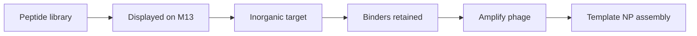

# Phage Display

Phage display is described as a molecular technique where foreign peptides or proteins are expressed on the surface of bacteriophages [L10, p.19]. In the lecture, [[m13-bacteriophage]] can be used as a template for synthesis and assembly of nanomaterials by displaying peptides that bind inorganic structures such as ZnS nanocrystals [L10, p.19].

*Takeaway: phage display evolves peptide-coated templates that recognize inorganic materials [L10, p.19].*

## Selection model
Enrichment over rounds can be represented schematically:

$$f_{n+1}=\frac{a f_n}{a f_n+(1-f_n)}$$

| Symbol | Meaning | Units / notes |
|---|---|---|
| $f_n$ | binder fraction after round $n$ | dimensionless |
| $a$ | enrichment factor for binders | dimensionless |
| $f_{n+1}$ | binder fraction after next round | dimensionless |

Assumptions: simple outside-the-lecture enrichment model; real selections include nonspecific binding, amplification bias and target-dependent elution.

## Links
Connects [[m13-bacteriophage]], [[quantum-dots]] and [[microbial-nanomaterial-synthesis]].

