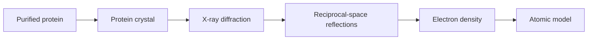
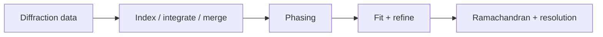

# Protein Crystallography

Protein crystallography is the central structural method in lecture 3. The notes list advantages: no size limitation, high resolution and static structures [L3, p.13]. It requires [[protein-crystals]], uses [[x-ray-diffraction]], interprets reflections in reciprocal space and fits an atomic model into [[electron-density]] [L3, pp.17,21–22].

*Takeaway: crystallography is a pipeline from purified protein to ordered crystal to diffraction to model.*

## Limits
The method needs crystals, and crystallisation depends on [[protein-crystallization-phase-diagram]], salt, pH, precipitant and reproducible screening [L3, pp.22–24].

## Links
Uses [[bragg-law]], [[reciprocal-space-fourier-transform]], [[crystallographic-symmetry]] and [[bravais-lattices]].

## Lecture 4 extension — data reduction and validation
Lecture 4 extends this page from crystal formation to the full workflow: data collection, [[crystallographic-data-processing]], [[phase-problem]] solution, model fitting, refinement, deposition and application [L4, p.4]. It stresses that amplitudes come from $I_h\propto |F_h|^2$ but phases must be recovered before an [[electron-density|electron-density map]] is interpretable [L4, p.1]. Model validation includes [[ramachandran-plot]] checks and resolution reporting [L4, p.2].

*Takeaway: crystallography is complete only after phasing and model validation.*

