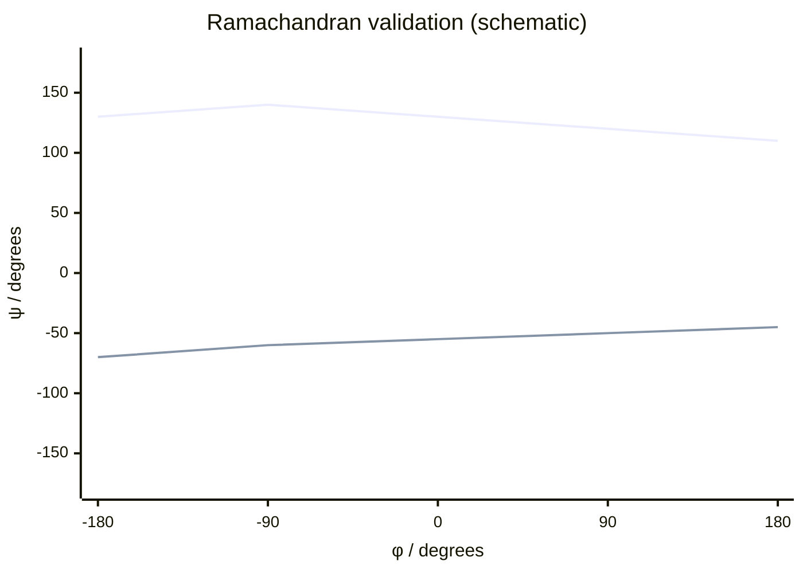

---
title: Ramachandran Plot
type: method
tags: [protein-structure, validation, dihedral-angles]
lectures: [L04]
updated: 2026-10-19
status: draft
---

# Ramachandran Plot

The Ramachandran plot validates protein backbone geometry by plotting dihedral angles $\phi$ and $\psi$ and checking allowed regions for helices, sheets and loops [L4, p.2].

| Angle | Meaning | Typical range |
|---|---|---|
| $\phi$ | torsion around N–C$_\alpha$ | $-180^\circ$ to $+180^\circ$ |
| $\psi$ | torsion around C$_\alpha$–C | $-180^\circ$ to $+180^\circ$ |

*Takeaway: a fitted model is checked against physically allowed backbone angles.*

