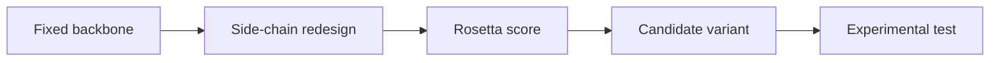

---
title: Rosetta Protein Design
type: method
tags: [rosetta, modelling, protein-design]
lectures: [L02]
updated: 2026-10-19
status: draft
---

# Rosetta Protein Design

Rosetta is presented as a computational protein/enzyme design platform. The notes mention multiple applications, CASP as a structure-prediction assessment, Rosetta combined with deep learning, and surface-design workflows that fix a backbone while redesigning residue side chains [L2, pp.10–11].

$$
E_{\mathrm{total}} = \sum_i (E_{\mathrm{vdW},i}+E_{\mathrm{elec},i}+E_{\mathrm{solv},i}+E_{\mathrm{Hbond},i}+E_{\mathrm{ref},i})
$$

| Symbol | Meaning | Units / notes |
|---|---|---|
| $E_{\mathrm{total}}$ | score of model | Rosetta energy units |
| $i$ | residue/interaction index | dimensionless |
| $E_{\mathrm{vdW}}$ | van der Waals term | model term |
| $E_{\mathrm{elec}}$ | electrostatic term | model term |
| $E_{\mathrm{solv}}$ | solvation term | model term |
| $E_{\mathrm{Hbond}}$ | hydrogen-bond term | model term |
| $E_{\mathrm{ref}}$ | residue reference term | model term |

*Takeaway: Rosetta searches sequence/side-chain choices against a scoring function, then needs laboratory validation.*

## Links
Implements [[rational-protein-design]], benchmarked by [[casp]] and applied to [[green-fluorescent-protein]].
