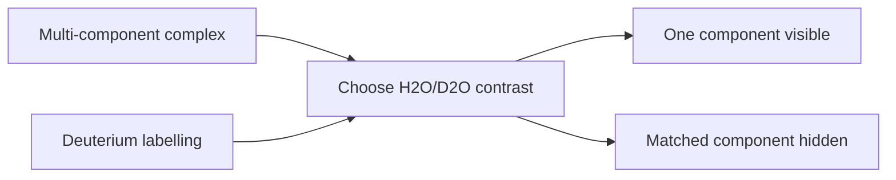

---
title: SANS Contrast Variation
type: method
tags: [sans, contrast-variation, deuterium]
lectures: [L06]
updated: 2026-10-19
status: draft
---

# SANS Contrast Variation

SANS contrast variation exploits different scattering length densities of components, for example DNA versus protein or nanoparticle shells [L6, p.26]. Deuterium labelling/water can highlight or mask components [L6, p.26].

*Takeaway: contrast variation separates overlapping components without physically separating them.*

