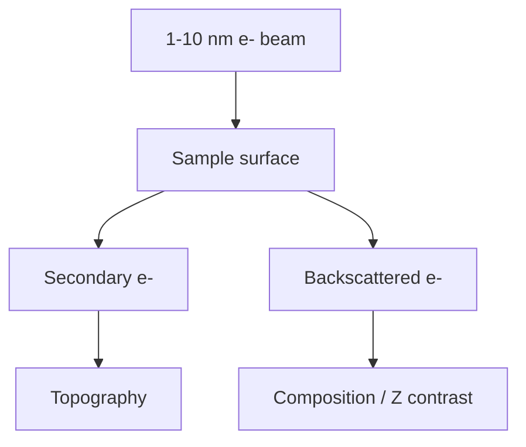

# Scanning Electron Microscopy

Scanning electron microscopy (SEM) scans a low-energy electron beam over a surface to analyse surface structure and composition [L9, p.11]. Secondary electrons provide topographical information, while backscattered electrons reflect from the sample and give compositional contrast because heavier elements scatter more electrons back [L9, p.11].

*Takeaway: SEM separates surface topography from composition using different emitted electron signals [L9, p.11].*

## Physics
Electron interaction volume limits spatial resolution and depth sensitivity:

$$V_{\mathrm{int}}\propto E_0^{n} Z^{-m}$$

| Symbol | Meaning | Units / notes |
|---|---|---|
| $V_{\mathrm{int}}$ | electron interaction volume | m$^3$ |
| $E_0$ | incident electron energy | keV |
| $Z$ | atomic number | dimensionless |
| $n,m$ | empirical exponents | dimensionless |

Assumptions: schematic scaling only; exact interaction volume depends on material density, energy and geometry. The lecture-level point is that SEM probes near-surface structure with strong electron-sample interactions [L9, p.11].

## Links
Related to [[electron-microscopy]], [[energy-dispersive-x-ray-spectroscopy]] and [[transmission-electron-microscopy]].

