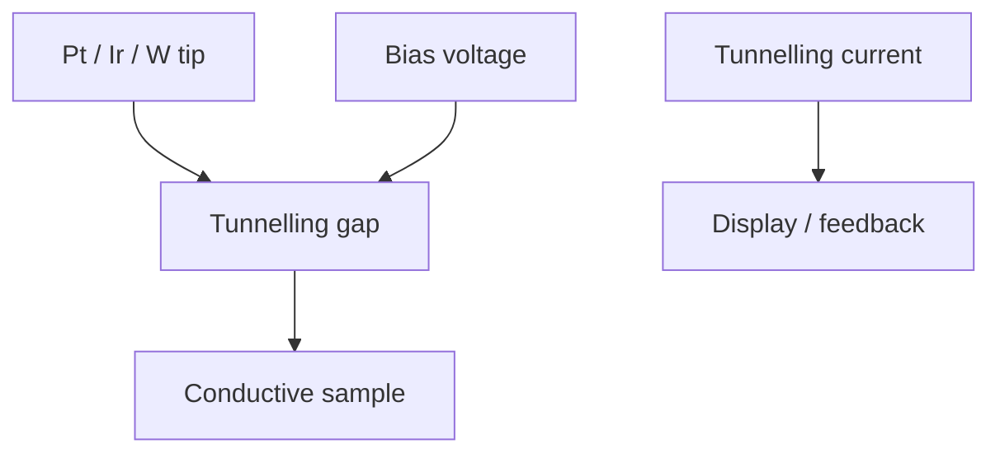

# Scanning Tunneling Microscopy

Scanning tunneling microscopy (STM) scans a fine metal tip over a conductive surface and measures tunnelling current [L12, p.15]. The notes distinguish constant-height mode, where height is kept fixed and current changes, from constant-current mode, where voltage/feedback changes are mapped [L12, p.15].

*Takeaway: STM converts an exponentially distance-sensitive current into a surface map [L12, p.15].*

## Physics
$$I(z)\propto V\exp(-2\kappa z)$$

| Symbol | Meaning | Units / notes |
|---|---|---|
| $I$ | tunnelling current | A |
| $z$ | tip-sample distance | nm |
| $V$ | bias voltage | V |
| $\kappa$ | barrier decay constant | nm$^{-1}$ |

Assumptions and limits: a simple vacuum-barrier expression. The scan notes that STM and AFM characterise and can manipulate/structure surfaces, but STM does not directly map atoms one-to-one because electronic states contribute to contrast [L12, pp.15–17].

## Links
Related to [[atomic-force-microscopy]], [[electron-beam-lithography]], [[self-assembled-monolayers]] and [[L12]].

