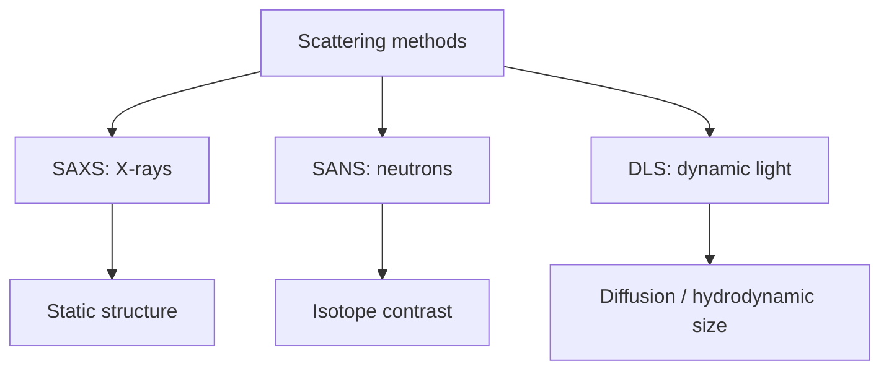

---
title: Scattering Methods
type: method
tags: [scattering, saxs, sans, dls]
lectures: [L06]
updated: 2026-10-19
status: draft
---

# Scattering Methods

Lecture 6 groups SAXS, SANS and DLS as scattering methods for nanoparticles and assemblies [L6, p.16]. They provide ensemble information without crystal growth, including size, shape, concentration, surface charge and assembly processes [L6, p.16].

*Takeaway: choose the method by contrast mechanism and static versus dynamic information.*

