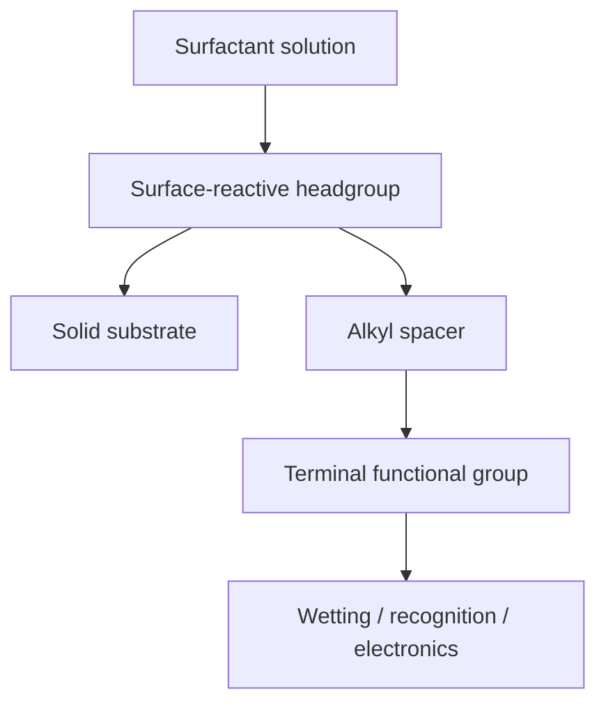

# Self-Assembled Monolayers

Self-assembled monolayers (SAMs) are spontaneous molecular films formed by immersing a solid substrate in a solution of surface-active molecules (surfactants) [L12, p.12]. Each molecule has a surface-reactive headgroup, a spacer chain and a terminal group that controls interfacial chemical functionality [L12, p.12].

*Takeaway: SAMs translate molecular end groups into surface properties [L12, p.12].*

## Examples from the scan
- Alkanethiols, disulfides and thioethers on gold [L12, p.12].
- Alkyltrichlorosilanes on hydroxylated surfaces [L12, p.12].
- Alcohols and amines on gold or platinum [L12, p.12].
- Carboxylic acids on Al$_2$O$_3$ [L12, p.12].

## Chemistry
A common gold-thiol binding motif is:

$$\mathrm{R{-}SH+Au_{surface}\rightarrow Au{-}S{-}R+\tfrac{1}{2}H_2}$$

| Symbol | Meaning | Units / notes |
|---|---|---|
| $\mathrm{R{-}SH}$ | thiol-terminated molecule | mol L$^{-1}$ |
| $\mathrm{Au_{surface}}$ | gold substrate surface site | surface site density, m$^{-2}$ |
| $\mathrm{Au{-}S{-}R}$ | bound thiolate species | surface species |
| $\mathrm{H_2}$ | hydrogen byproduct in simplified oxidative addition picture | mol |

Assumptions and limits: simplified surface reaction. The lecture lists oxidative addition of S-H bonds and reductive elimination of hydrogen for thiol/disulfide monolayers, but real Au-S SAM formation depends on surface state and environment [L12, p.11].

## Links
Related to [[langmuir-blodgett-films]], [[dna-mediated-nanoparticle-assembly]], [[superhydrophobicity-lotus-effect]] and [[scanning-tunneling-microscopy]].

