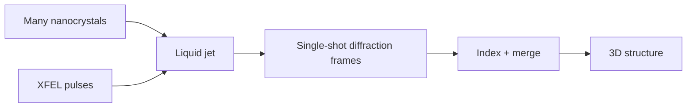

# Serial Femtosecond Crystallography

Serial femtosecond crystallography (SFX) injects micro- or nanocrystals in a liquid jet and hits them with [[x-ray-free-electron-laser]] pulses to collect diffraction patterns [L7, p.5]. It enables high-resolution biomolecular structures from many randomly oriented nanocrystals, with no rotation required in the serial data-collection scheme [L8, p.9].

*Takeaway: SFX replaces one rotating large crystal with many single-shot nanocrystal diffraction patterns [L7, p.5; L8, p.9].*

## Physics
Diffraction still follows reciprocal-space sampling:

$$q=\frac{4\pi}{\lambda}\sin\theta$$

| Symbol | Meaning | Units / notes |
|---|---|---|
| $q$ | scattering vector magnitude | m$^{-1}$ |
| $\lambda$ | X-ray wavelength | m |
| $\theta$ | half scattering angle | rad or degrees |

Assumptions: each crystal orientation samples a slice of reciprocal space; many indexed frames are needed for completeness [L8, p.9].

## Links
Related to [[protein-crystallography]], [[x-ray-diffraction]] and [[coherent-x-ray-imaging]].

