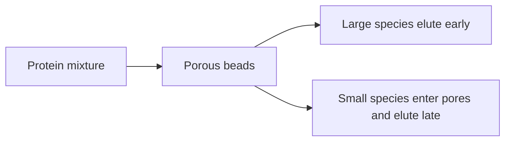

---
title: Size Exclusion Chromatography
type: method
tags: [chromatography, size, purification]
lectures: [L01]
updated: 2026-10-19
status: draft
---

# Size Exclusion Chromatography

Size exclusion chromatography (SEC) is listed as a filter-like purification step. The notes say it gives high purity and a polishing step, but impurities can stick to the column [L1, p.8].

*Takeaway: SEC separates by hydrodynamic size rather than binding chemistry.*

## Trade-offs
The lecture gives the general chromatography trade-off: speed, resolution, recovery and capacity [L1, p.8]. SEC has gentle conditions but limited sample capacity.

## Links
Used with [[fplc]] after [[recombinant-protein-production]].
