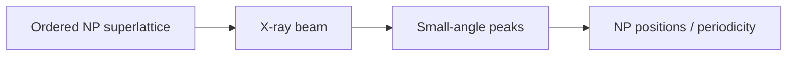

---
title: Small-Angle X-ray Diffraction
type: method
tags: [saxd, nanoparticle-lattices, diffraction]
lectures: [L06]
updated: 2026-10-19
status: draft
---

# Small-Angle X-ray Diffraction

Small-angle X-ray diffraction (SAXD) reports nanoscale ordering rather than atomic lattice ordering [L6, p.25]. It reveals mesoscale order, powder diffraction peaks and nanoparticle positions in superlattices [L6, p.25].

*Takeaway: SAXD reads periodic nanoparticle positions, not atom positions inside the NP.*

