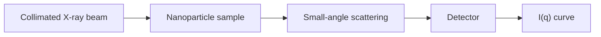

---
title: Small-Angle X-ray Scattering
type: method
tags: [saxs, x-ray, nanostructure]
lectures: [L06]
updated: 2026-10-19
status: draft
---

# Small-Angle X-ray Scattering

Small-angle X-ray scattering (SAXS) measures X-rays scattered at small angles by nm-scale structures [L6, pp.16,22–23]. It is solution based, relatively fast, can be in situ and reports averaged 3D structural information [L6, p.16].

$$q=|\mathbf q|=\frac{4\pi}{\lambda}\sin\theta$$

| Symbol | Meaning | Units / notes |
|---|---|---|
| $q$ | scattering-vector magnitude | nm$^{-1}$ |
| $\lambda$ | X-ray wavelength | nm |
| $\theta$ | scattering angle convention in sketch | rad or degrees |

*Takeaway: SAXS converts nanoscale electron-density contrast into an intensity curve.*

