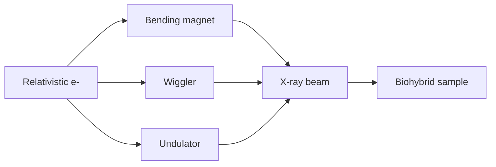

# Synchrotron Radiation

Synchrotron radiation is generated when electrons moving near the speed of light are forced along a curved path by bending magnets, wigglers or undulators [L7, p.1]. Compared with a lab X-ray tube, it offers higher brilliance, tunable wavelength, narrow divergence and low bandwidth, making it useful for high-resolution imaging, spectroscopy and time-resolved measurements [L7, pp.1,6].

*Takeaway: magnetic acceleration turns stored electron energy into intense, directed X-rays [L7, p.1].*

## Physics
The lecture’s “high brilliance” message can be expressed qualitatively as photons per area, solid angle and bandwidth:

$$B=\frac{N_\gamma}{A\,\Omega\,t\,(\Delta E/E)}$$

| Symbol | Meaning | Units / notes |
|---|---|---|
| $B$ | brilliance | photons s$^{-1}$ mm$^{-2}$ mrad$^{-2}$ per 0.1% bandwidth |
| $N_\gamma$ | photon number | photons |
| $A$ | source area | mm$^2$ |
| $\Omega$ | beam solid angle | mrad$^2$ |
| $t$ | time | s |
| $\Delta E/E$ | relative energy bandwidth | dimensionless |

Assumptions: this is a beam-quality definition, not a source-design equation. High brilliance improves resolution, focusing and signal-to-noise [L7, p.1].

## Links
Used by [[x-ray-absorption-near-edge-structure]], [[x-ray-fluorescence-spectroscopy]], [[x-ray-free-electron-laser]]-adjacent methods and tomography for [[biominerals]].

