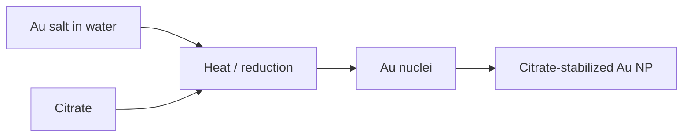

---
title: Turkevich Method
type: method
tags: [gold, nanoparticle-synthesis, citrate]
lectures: [L05]
updated: 2026-10-19
status: draft
---

# Turkevich Method

The Turkevich method is listed for Au nanoparticles: citrate reduces/stabilises Au and leaves citrate ions on the surface [L5, p.11].

*Takeaway: citrate provides both weak reduction and electrostatic stabilisation.*

No recipe concentrations or temperatures are given in the notes [L5, p.11].

