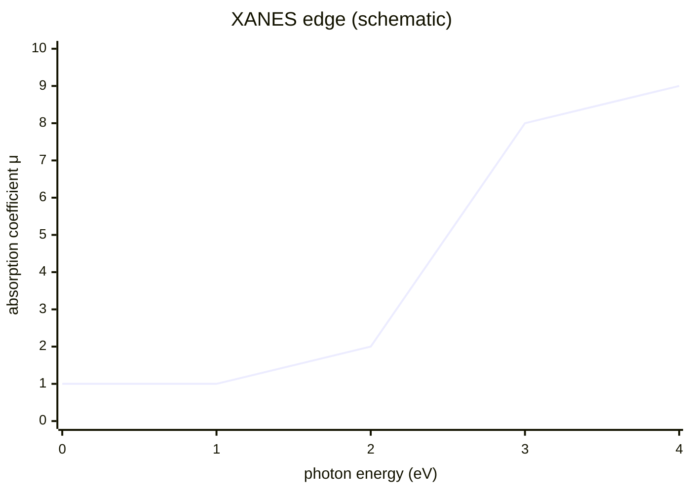

# X-ray Absorption Near Edge Structure

X-ray absorption near edge structure (XANES) measures how X-ray absorption changes near an element-specific absorption edge [L7, p.2]. The edge and fine structure report oxidation state, electronic environment and local coordination because the ejected photoelectron is scattered by neighbouring atoms [L7, p.2].

*Takeaway: the absorption edge marks an element-specific core-level transition [L7, p.2].*

## Physics
Beer-Lambert attenuation links measured intensity to absorption:

$$I=I_0e^{-\mu x}$$

| Symbol | Meaning | Units / notes |
|---|---|---|
| $I$ | transmitted X-ray intensity | counts s$^{-1}$ |
| $I_0$ | incident X-ray intensity | counts s$^{-1}$ |
| $\mu$ | absorption coefficient | m$^{-1}$ |
| $x$ | sample thickness | m |

Assumptions: homogeneous absorber and negligible multiple scattering in the simple attenuation model. XANES interpretation compares measured spectra with standards [L7, p.2].

## Links
Complements [[x-ray-fluorescence-spectroscopy]]: XANES gives oxidation/electronic structure, XRF gives elemental distribution [L7, p.2].

