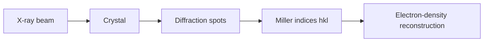
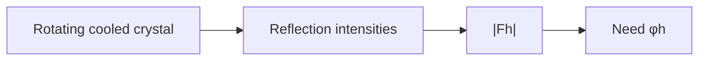
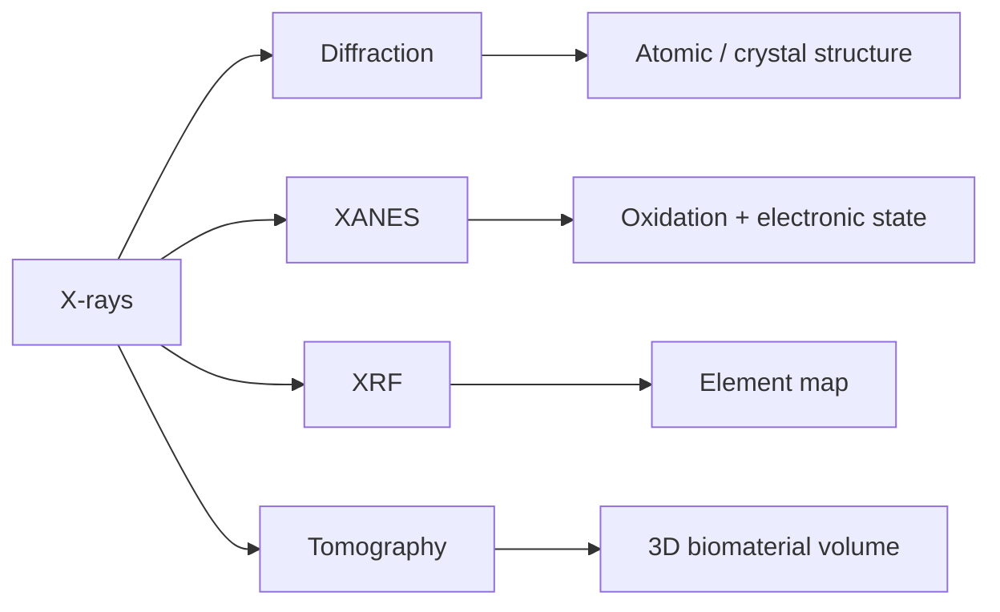

---
title: X-ray Diffraction
type: method
tags: [x-ray, diffraction, crystallography]
lectures: [L03, L04, L07]
updated: 2026-10-19
status: draft
---

# X-ray Diffraction

X-ray diffraction is introduced with a beam hitting a crystal and producing a diffraction image [L3, p.17]. The notes state that X-rays are useful because their wavelength is similar to the features of molecules and that they interact with the electrons of atoms inside the crystal [L3, p.17].

*Takeaway: X-ray spots encode periodic electron-density features of the crystal.*

## Links
Explained quantitatively by [[bragg-law]] and interpreted with [[reciprocal-space-fourier-transform]].

## Lecture 4 extension — amplitudes, phases and radiation damage
Lecture 4 adds the structure-factor view: X-ray diffraction records intensities related to amplitudes, while missing phases create the [[phase-problem]] [L4, p.1]. During data collection the crystal is rotated to sample all angles and cooled to reduce atomic vibration and radiation damage [L4, p.1].

*Takeaway: diffraction images are incomplete Fourier measurements until phases are supplied.*

## Lecture 7 extension — X-rays as a biohybrid probe
Lecture 7 generalises X-ray methods beyond crystals: X-rays have short wavelengths, greater penetration depth than electrons or visible microscopy, element-specific interactions, and can image biological samples non-destructively if dose is controlled [L7, p.1]. Laboratory X-ray tubes are lower-intensity and fixed-wavelength, whereas [[synchrotron-radiation]] gives high brilliance, tunable wavelength and low divergence [L7, p.1].

*Takeaway: the same X-ray interaction family supports structural, chemical and volumetric biohybrid measurements [L7, pp.1–4].*
