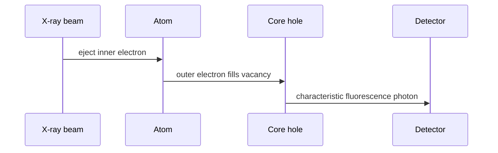

# X-ray Fluorescence Spectroscopy

X-ray fluorescence spectroscopy (XRF) excites an atom with X-rays, creates a core hole and detects the characteristic fluorescent photon emitted during electronic relaxation [L7, p.2]. Because the emitted energies are element-specific, XRF is used for elemental analysis, 3D elemental maps and cancer-research imaging examples in the notes [L7, p.2].

*Takeaway: fluorescence energy identifies the element, while scanning maps its distribution [L7, p.2].*

## Physics
Characteristic emission energy is the difference between two atomic levels:

$$E_\gamma=E_i-E_f=h\nu$$

| Symbol | Meaning | Units / notes |
|---|---|---|
| $E_\gamma$ | fluorescence photon energy | eV or keV |
| $E_i$ | initial electronic level energy | eV |
| $E_f$ | final electronic level energy | eV |
| $h$ | Planck constant | J s |
| $\nu$ | photon frequency | Hz |

Assumptions: line energies are element-specific, but matrix absorption and detector efficiency affect quantitative maps [L7, p.2].

## Links
Related to [[energy-dispersive-x-ray-spectroscopy]], which detects characteristic X-rays generated by an electron beam rather than an X-ray beam [L8, p.7].

