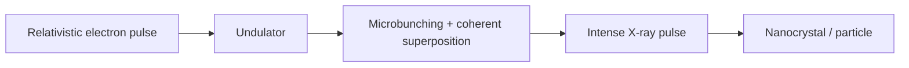

# X-ray Free Electron Laser

An X-ray free electron laser (XFEL) produces extremely short, intense X-ray pulses from relativistic electron bunches passing through an undulator [L7, p.5]. The notes stress femtosecond pulses, high brilliance and suitability for time-resolved studies of dynamic processes and radiation-sensitive particles or molecules [L7, p.5].

*Takeaway: XFELs turn electron bunching in undulators into coherent femtosecond X-ray flashes [L7, p.5].*

## Physics
Pulse duration defines the time window of the measurement:

$$\Delta x \approx c\Delta t$$

| Symbol | Meaning | Units / notes |
|---|---|---|
| $\Delta x$ | light-travel distance during pulse | m |
| $c$ | speed of light | m s$^{-1}$ |
| $\Delta t$ | pulse duration | s, femtoseconds in XFEL context |

Assumptions: this only estimates temporal resolution length scale; actual structural resolution depends on diffraction signal, damage and reconstruction.

## Links
Enables [[serial-femtosecond-crystallography]] and [[coherent-x-ray-imaging]] [L7, p.5].

