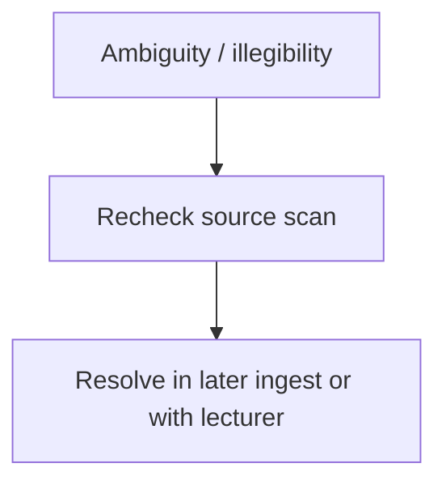

# Open Questions

*Takeaway: unresolved points are kept explicit rather than silently guessed.*

## From ingest of lectures 1–3
- **Page-order ambiguity:** `1_2_3_p08.png` appears after a Wdh 2 page but is headed “Biohybrid Nanostructures – Wdh 1” and continues chromatography/protein-purification conclusions. It is assigned to [[L01]]; [[L02]] uses pp. 7 and 9–12.
- **L1 p.4 stereochemistry drawings:** the conceptual message L-peptides vs D-peptides is clear, but some drawn atom labels are too small to transcribe confidently.
- **L2 p.7 designed-enzyme example:** the note appears to say an enzyme designed with Rosetta catalyses cleavage of an aldol product, but the exact substrate/product name is not fully legible.
- **L3 p.18 point-group examples:** the drawn example molecules/symmetry cartoons are not labelled enough to identify the molecule beyond C2/C2v-style point-group examples.
- **L3 p.19 P1 vs P-1 note:** the sentence comparing asymmetric-unit size is partly hard to read; recorded as “P1 equals entire unit cell; P-1 half of the unit cell,” but should be rechecked.

## From ingest of lectures 4–6
- **Lecture-boundary check:** pages 1–5 are headed Wdh 4, pages 6–15 Wdh 5 or continuation of Wdh 5, and pages 16–26 Wdh 6. Page 11 has no clearly legible Wdh number in the header but continues the L5 synthesis sequence, so it is assigned to [[L05]].
- **L4 p.2 $R_{\mathrm{merge}}$ thresholds:** the notes show both “<10%” and “<30%”; the intended quality context for each value should be confirmed.
- **L4 p.3 database validation:** the page says a validation report is generated and structure quality is not checked in the database, but the named database/portal is not legible.
- **L5 p.12 reducing agents:** the seed-growth notes mention NaBH$_4$ and ascorbic acid, but the exact line is compressed; roles are recorded only as reducing agents.
- **L6 p.24 DNA ligand drawing:** the concept of DNA-mediated nanoparticle assembly is clear, but the exact sequence/chemistry is not legible.
- **L6 p.26 final comparison:** the final sentence comparing SAXS and SANS is cut off after “while …”.

## From ingest of lectures 7–10
- **Lecture-boundary check:** pages 1–6 are headed Wdh 7, pages 7–10 are headed Wdh 8, pages 11–15 are headed Wdh 9, and pages 16–22 are headed Wdh 10. No scan-order anomaly was found for this PDF.
- **L7 p.4 tomography note:** the small note comparing tomography/SAXS/WAXS or “diff. betw.” near the bone example is compressed; only the general 3D/tensor tomography point is recorded.
- **L8 p.8 negative staining:** the heavy-atom stain example appears to be uranium/uranyl stain, but the exact chemical name should be rechecked.
- **L9 p.12 nucleation formula:** the rate expression includes a handwritten constant transcribed as $C$; its definition is not given in the scan.
- **L9 p.15 apoferritin distribution note:** the bottom question about whether pore/cavity distribution leads to a constant cavity size or overly broad products is partly illegible.
- **L10 p.18 Shewanella gene-circuit note:** the TMAO/cytochrome-expression note is legible in outline but the exact metal oxidation-state target beside it is compressed.
- **L10 p.21 magnetite/superlattice note:** the line is read as assembly of Fe$_3$O$_4$ and Co into magnetic structures, but the exact formulation should be rechecked.

## From ingest of lectures 11–13
- **Lecture-boundary check:** pages 1–7 are headed Wdh 11, pages 8–17 are headed Wdh 12, and pages 18–22 are headed Wdh 13. No scan-order anomaly was found for this PDF.
- **L11 p.3 protein-container identity:** the exact protein-container label in the Rosetta/ferritin surface-charge section is compressed; content is recorded as ferritin-like/protein-container redesign.
- **L11 p.4 cerium oxide note:** the catalyst example appears to be cerium oxide with Ce-containing species and colour change, but the exact solution/crystal colour annotations should be rechecked.
- **L12 p.14 molecular-machine example:** the meso isomer and helix-inversion sketch are legible in mechanism but not exact compound name.
- **L13 p.19 photosensitizer name:** the ferritin photodynamic therapy note appears to mention a zinc phthalocyanine-like photosensitizer; exact name is not confidently legible.
- **L13 p.20 ferritin microparticle question:** why adding ferritin during microparticle synthesis improves distribution/loading compared with adding it after microparticles are already produced remains open.
- **L13 p.22 rubisco microcompartment note:** the bottom note asks why rubisco is compartmentalised; the written answer is incomplete and should be checked against the lecture.

## From lint pass 2026-10-19
- **Contradictions:** no confirmed contradictions were found between wiki pages during the lint pass. The repeated terms that most need human/source judgement are terminology overlaps rather than clear conflicts: “structure factor” in crystallography versus SAXS/SANS, PDI in DLS versus GPC, and ferritin/apoferritin/protein-container naming across L9, L11 and L13.
- **Tiny pages to expand:** 59 pages have very little prose (<120 non-code words), especially short concept/method notes from the first ingestion passes. They are linked, diagrammed and not `status: stub`, but should be expanded before treating the wiki as exam-ready.
- [x] **Suggested concept pages:** created dedicated pages for localized surface plasmon resonance, photothermal therapy, theranostics, surface charge, surface energy, supersaturation, isoelectric point, hydrophobic effect, van der Waals interactions, Brownian motion, nanotoxicity/size-dependent toxicity, ligand shells, Debye length/slipping plane, electron density and activation energy.
- **Suggested source rechecks:** prioritise scan checks for the already-flagged numerical/chemical ambiguities: L4 p.2 $R_{\mathrm{merge}}$ thresholds, L6 p.26 SAXS/SANS comparison, L9 p.12 nucleation constant $C$, L11 p.4 cerium oxide colour/species note, L13 p.19 photosensitizer identity and L13 p.22 rubisco compartmentalisation note.
