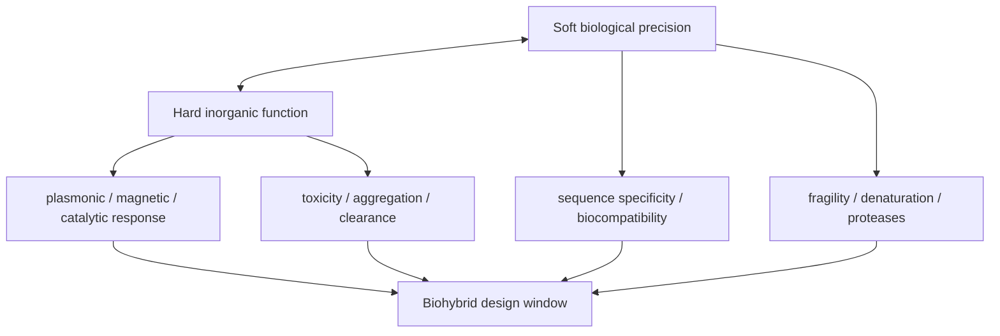
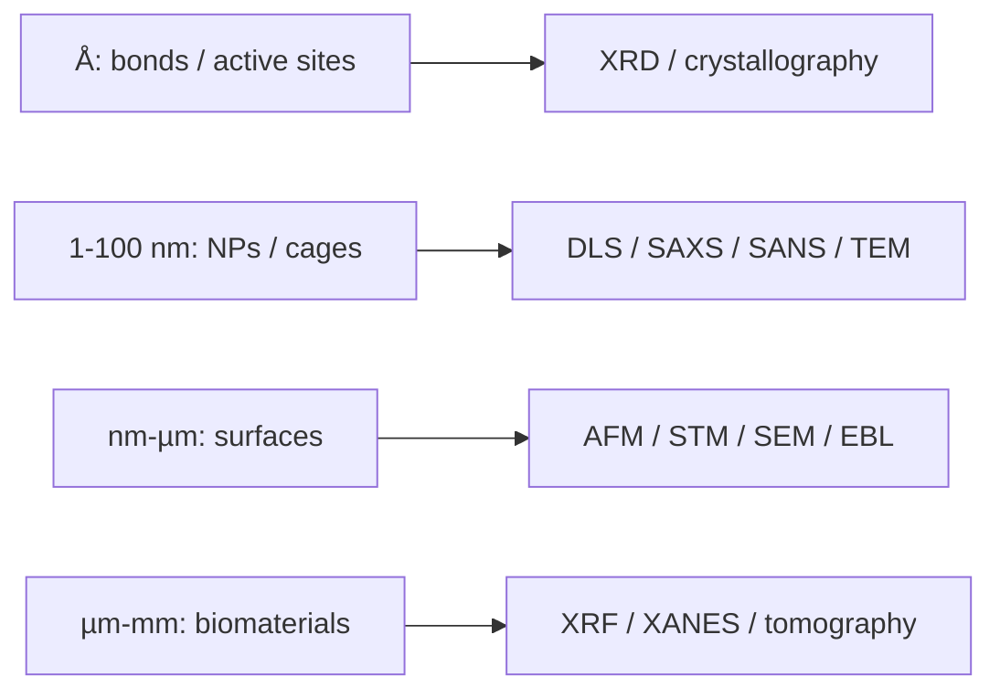

---
title: Overview
type: meta
tags: [overview]
updated: 2026-10-19
status: solid
---

# Overview — Biohybrid Nanostructures

Lectures 1–13 now form the full module arc: biomolecules and recombinant production create programmable biological parts; protein design and crystallography validate molecular structure; nanoparticle synthesis adds inorganic function; scattering, X-ray and electron methods characterise colloids and biomaterials; biomineralization, protein cages and microbial systems use biology as a nanoreactor; and the final lectures convert those parts into ordered protein/DNA assemblies, surface nanostructures and biomedical applications.

```mermaid
flowchart LR
  L1["L01: biomolecules + production"] --> L2["L02: catalysis + design"]
  L2 --> L3["L03: crystallography + solubility"]
  L3 --> L4["L04: phasing + prediction"]
  L4 --> L5["L05: nanoparticle synthesis"]
  L5 --> L6["L06: scattering + ζ potential"]
  L6 --> L7["L07: synchrotron X-rays + biomaterials"]
  L7 --> L8["L08: electron microscopy"]
  L8 --> L9["L09: biomineralization + ferritin"]
  L9 --> L10["L10: microbial synthesis + supercrystals"]
  L10 --> L11["L11: protein/DNA NP assemblies"]
  L11 --> L12["L12: surfaces + lithography"]
  L12 --> L13["L13: nanomedicine"]
  L13 --> L5
  L13 --> L6
```

*Takeaway: the module expands from protein structure to inorganic colloids, then to biological control, surface organisation and biomedical function.*

## Lecture map
- [[L01]] introduces [[biomolecules]], [[amino-acids-peptides]], [[protein-structure]], [[genetic-code-central-dogma]], [[recombinant-protein-production]] and chromatography.
- [[L02]] turns proteins into design objects through [[enzyme-catalysis]], [[rational-protein-design]], [[rosetta-protein-design]], [[directed-evolution]], [[protein-cages]], [[green-fluorescent-protein]] and [[designed-ankyrin-repeat-proteins]].
- [[L03]] explains [[nmr]], [[cryo-em]], [[protein-crystallography]], [[crystallographic-symmetry]], [[bravais-lattices]], [[x-ray-diffraction]], [[bragg-law]], [[reciprocal-space-fourier-transform]] and [[protein-crystallization-phase-diagram]].
- [[L04]] adds [[structure-factor]], [[phase-problem]], [[crystallographic-data-processing]], [[ramachandran-plot]], [[molecular-replacement]], [[direct-methods]], [[anomalous-dispersion]], [[protein-folding-problem]], [[alphafold]] and [[protein-mpnn]].
- [[L05]] introduces [[nanoparticles]], [[classical-nucleation-theory]], [[coalescence-ostwald-ripening]], [[nanoparticle-stabilization]], [[electrical-double-layer]], [[steric-stabilization]], [[gold-nanoparticles]], [[turkevich-method]], [[seed-mediated-growth]], [[nanoparticle-ligands]], [[ligand-exchange]], [[nanoparticle-synthesis-in-nanoreactors]], [[hot-injection]] and [[quantum-dots]].
- [[L06]] characterises colloids with [[scattering-methods]], [[dynamic-light-scattering]], [[stokes-einstein-equation]], [[polydispersity-index]], [[zeta-potential]], [[electrophoretic-light-scattering]], [[small-angle-x-ray-scattering]], [[guinier-analysis]], [[saxs-form-structure-factor]], [[small-angle-x-ray-diffraction]], [[neutron-scattering]], [[sans-contrast-variation]] and [[dna-mediated-nanoparticle-assembly]].
- [[L07]] extends structural characterisation through [[synchrotron-radiation]], [[x-ray-absorption-near-edge-structure]], [[x-ray-fluorescence-spectroscopy]], [[x-ray-free-electron-laser]], [[serial-femtosecond-crystallography]], [[coherent-x-ray-imaging]], [[nanoparticle-drug-delivery]] and [[biominerals]].
- [[L08]] compares electron-based imaging and analysis: [[electron-microscopy]], [[energy-dispersive-x-ray-spectroscopy]], [[electron-energy-loss-spectroscopy]], [[cryo-em]], [[transmission-electron-microscopy]] and [[scanning-electron-microscopy]].
- [[L09]] introduces [[biomineralization]], [[controlled-nucleation-growth]], [[protein-cages]], [[ferritin]], [[apoferritin]] and protein-cage [[nanoparticle-synthesis-in-nanoreactors]].
- [[L10]] covers [[microbial-nanomaterial-synthesis]], biologically produced [[quantum-dots]], [[shewanella-oneidensis]], [[m13-bacteriophage]], [[phage-display]], [[curli-fibers]], [[plasmonic-supercrystals]] and [[sers-biosensing]].
- [[L11]] covers [[biohybrid-conductive-materials]], [[protein-crystal-nanoparticle-superlattices]], [[gold-nanoparticles]], [[gold-nanorods]], [[plasmon-exciton-coupling]] and [[dna-mediated-nanoparticle-assembly]].
- [[L12]] covers [[superhydrophobicity-lotus-effect]], [[dna-origami]], [[atomic-force-microscopy]], [[self-assembled-monolayers]], [[langmuir-blodgett-films]], [[scanning-tunneling-microscopy]] and [[electron-beam-lithography]].
- [[L13]] covers [[protein-based-nanomedicine]], [[nanoparticle-drug-delivery]], [[ferritin]], [[gold-nanorods]], [[dna-nanorobots]] and [[sirna-delivery]].

## Central through-line
The module repeatedly asks how molecular structure creates function. Lectures 1–4 establish protein structure and validation; lectures 5–6 generalise the logic to inorganic colloids; lectures 7–8 show that characterisation is multi-modal and dose-limited; lectures 9–10 show biology controlling inorganic nucleation, growth, compartmentalization and superstructure formation; lectures 11–12 show how that control becomes ordered materials and patterned surfaces; and lecture 13 closes with function under biological constraints: toxicity, clearance, biodegradability, release and scalability.

## Complete module trade-offs

*Takeaway: every application sits between soft biological precision and hard-material function.*

## Characterisation across length scales

*Takeaway: the method follows the length scale and contrast mechanism, not a single universal instrument.*
