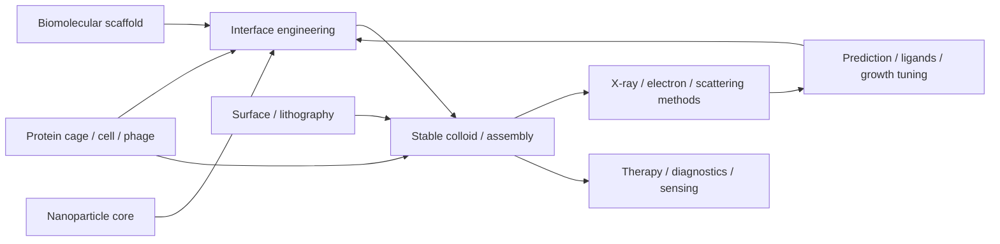
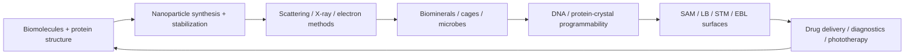

---
title: Synthesis
type: meta
tags: [synthesis]
updated: 2026-10-19
status: solid
---

# Synthesis

The full module argues that biohybrid nanostructures are made by iterating between **interface design**, **measurement**, **biological templating** and **application constraints**. Proteins bring sequence-programmed structure; DNA brings programmable recognition and geometry; nanoparticles bring plasmonic, magnetic, fluorescent or catalytic functions; ligands, ions, compartments, surfaces and cells decide whether objects remain soluble, nucleate, mineralize, assemble, pattern or work in biology.

*Takeaway: design decisions live at interfaces, compartments, surfaces and biological templates, then are judged by complementary measurements and application limits.*

## Recurring principles
1. **Hierarchy:** monomers become polymers, folds, crystals, nanoparticles, colloids and superlattices.
2. **Surface dominates nanoscale behaviour:** protein solubility, crystal contacts, nanoparticle nucleation, ligand shells and zeta potential all depend on exposed interfaces.
3. **Weak interactions become strong collectively:** hydrogen bonds, electrostatics, hydrophobicity, van der Waals forces, steric shells and DNA hybridisation add up.
4. **Prediction needs validation:** Rosetta, [[alphafold]] and [[protein-mpnn]] propose structures; crystallography, DLS, SAXS and SANS test them.
5. **Distributions matter:** nanoparticle products are not atomically precise; PDI, $R_{\mathrm{merge}}$, resolution and scattering fits are quality metrics.
6. **Contrast is a design variable:** X-rays see electrons, neutrons see nuclei/isotopes, and light scattering sees Brownian dynamics.
7. **Dose and damage limit knowledge:** X-ray and electron probes offer high resolution, but radiation damage, vacuum and staining can perturb biological material.
8. **Biology can be the reactor:** ferritin cavities, apoferritin shells, phytochelatins, phage-displayed peptides, curli fibers and bacterial redox pathways all localize inorganic formation.
9. **Function emerges from order:** biomineral hierarchy gives mechanical function; plasmonic supercrystals give optical hot spots; microbial routes give water-compatible products but harder mechanisms.
10. **Programmability changes the assembly problem:** DNA origami and DNA linkers turn recognition into geometry, while protein-crystal scaffolds turn protein packing into nanoparticle placement.
11. **Surfaces are devices:** SAMs, LB films, STM and EBL convert colloidal and biomolecular chemistry into addressable interfaces.
12. **Applications reintroduce biology as a constraint:** drug delivery must balance targeting, cargo loading, toxicity, clearance, biodegradation and scalable manufacturing.

## Provisional thesis
Biohybrid nanostructure design is best understood as **measured biological interface engineering under application constraints**: choose biological and inorganic building blocks, tune the surface chemistry or compartment that connects them, use biological templates when they provide spatial control, pattern surfaces when device integration matters, and use complementary methods to decide whether the intended nanoscale organisation actually formed and remains useful.

## Final synthesis diagram

*Takeaway: the course is circular: applications force a return to biomolecular compatibility and measurement.*
